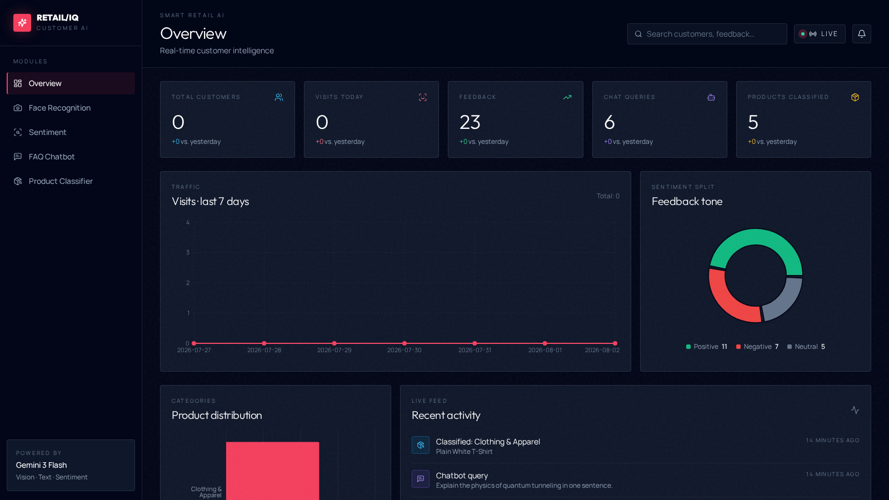
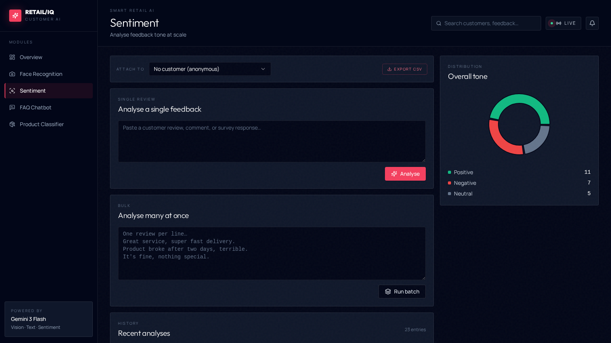
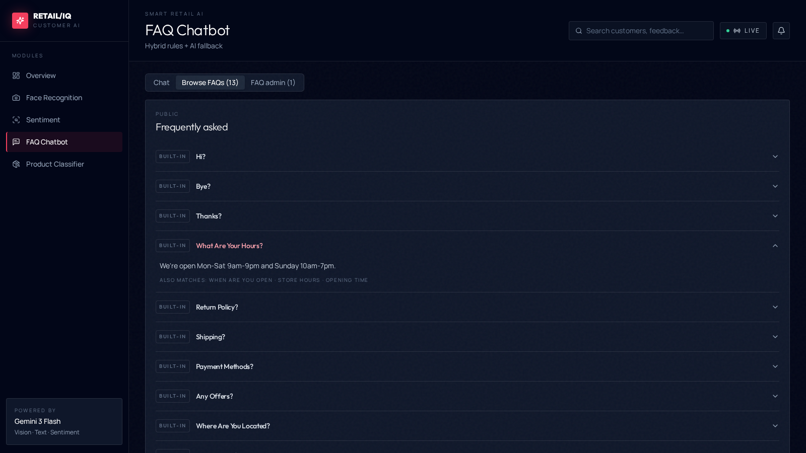

# AI Smart Retail & Customer Intelligence Platform

A full-stack web app for retail businesses — recognise returning customers,
analyse feedback sentiment, answer FAQs via a chatbot, classify products, and
mark VIPs for staff. All powered by AI, exposed through a FastAPI backend and
a React dashboard.


## Screenshots

| Overview dashboard | Sentiment module | Public FAQ browser |
| --- | --- | --- |
|  |  |  |

## Modules

| Module              | Description                                                     | AI                    |
| ------------------- | --------------------------------------------------------------- | --------------------- |
| Dashboard           | Live stats, sentiment donut, visit timeline, category bar chart | —                     |
| Face Recognition    | Webcam capture → register / recognize customers + VIP alerts    | Gemini 3 Flash Vision |
| Sentiment           | Single or bulk review classification with CSV export            | Gemini 3 Flash        |
| FAQ Chatbot         | Rule-based intent match + Gemini fallback, public FAQ browser   | Gemini 3 Flash        |
| Product Classifier  | Drag-and-drop image → fixed retail category + confidence        | Gemini 3 Flash Vision |
| Customer drill-down | Per-customer visits, feedback, browsed products                 | —                     |

## Stack

- **Frontend** — React 19 (CRA + craco), Tailwind, shadcn/ui, Recharts,
  react-webcam, react-router-dom, sonner.
- **Backend** — FastAPI + Motor (async MongoDB) + Pydantic v2.
- **AI** — `emergentintegrations` targeting `gemini-3-flash-preview` via the
  Emergent Universal LLM key (`EMERGENT_LLM_KEY`).
- **Database** — MongoDB collections: `customers`, `visits`, `feedback`,
  `chat_messages`, `products`, `faqs`.

---

## Quick start (local)

### Prerequisites

- **Python 3.11+**
- **Node 18+** with **Yarn**
- **MongoDB 6+** running locally (or a MongoDB Atlas connection string)
- An **Emergent LLM key** (or your own OpenAI/Anthropic/Google key)

### 1. Clone

```bash
git clone https://github.com/<your-username>/smart-retail-ai.git
cd smart-retail-ai
```

### 2. Backend

```bash
cd backend
python -m venv .venv
source .venv/bin/activate            # Windows: .venv\Scripts\activate
pip install -r requirements.txt

# Configure env
cp .env.example .env
# → edit .env and paste your EMERGENT_LLM_KEY
```

Start MongoDB (skip if you already have it running):

```bash
# macOS (Homebrew):    brew services start mongodb-community
# Linux (systemd):     sudo systemctl start mongod
# Windows:             net start MongoDB
# Or use Docker:       docker run -d -p 27017:27017 --name mongo mongo:7
```

Run the API:

```bash
uvicorn server:app --reload --host 0.0.0.0 --port 8001
```

- Swagger UI:  http://localhost:8001/docs
- Healthcheck: http://localhost:8001/api/health

### 3. Frontend

```bash
cd ../frontend
yarn install
cp .env.example .env
# .env already points at http://localhost:8001 — change only if your backend
# is elsewhere.
yarn start
```

Open http://localhost:3000

> The frontend proxies every call to `${REACT_APP_BACKEND_URL}/api/...`.

### 4. Grant webcam permission

The Face Recognition module needs camera access — allow it when the browser
prompts. Chrome only exposes `getUserMedia` on `https://` **or** `http://localhost`,
so keep the dev server on `localhost` (not `127.0.0.1`).

---

## API surface

All routes are under `/api`. Full interactive docs at `${BACKEND_URL}/docs`.

### Dashboard
- `GET /api/dashboard/stats`
- `GET /api/dashboard/visits-timeline?days=7`
- `GET /api/dashboard/category-distribution`
- `GET /api/dashboard/activity?limit=12`

### Sentiment
- `POST /api/sentiment/analyze` `{ text, source?, customer_id? }`
- `POST /api/sentiment/bulk` `{ items: [str], customer_id? }`
- `GET  /api/sentiment/history?limit=100`
- `GET  /api/sentiment/summary`
- `GET  /api/sentiment/export.csv`

### Chatbot
- `POST   /api/chat/message` `{ session_id, message }`
- `GET    /api/chat/history/{session_id}`
- `GET    /api/chat/sessions`
- `GET    /api/chat/faqs/public` — merged built-in + custom FAQs
- `GET    /api/chat/faqs`
- `POST   /api/chat/faqs`
- `DELETE /api/chat/faqs/{id}`

### Vision — Face
- `POST   /api/vision/face/register` `{ name, image_base64 }`
- `POST   /api/vision/face/recognize` `{ image_base64 }`
- `GET    /api/vision/face/customers`
- `GET    /api/vision/face/customers/{id}` — drill-down (visits + feedback + products)
- `PATCH  /api/vision/face/customers/{id}` `{ name?, is_vip? }`
- `DELETE /api/vision/face/customers/{id}`
- `GET    /api/vision/face/visits`
- `GET    /api/vision/face/visits/export.csv`

### Vision — Products
- `POST /api/vision/product/classify` `{ image_base64, filename?, customer_id? }`
- `GET  /api/vision/product/history`
- `GET  /api/vision/product/summary`

---

## Project structure

```
smart-retail-ai/
├── backend/
│   ├── data/
│   │   └── intents.json         # 13 built-in retail FAQ patterns
│   ├── routers/
│   │   ├── chatbot.py
│   │   ├── dashboard.py
│   │   ├── sentiment.py
│   │   └── vision.py            # face + product endpoints
│   ├── services/
│   │   ├── chatbot_service.py   # rule match + AI fallback
│   │   ├── face_service.py      # Gemini vision face matching
│   │   ├── llm.py               # emergentintegrations wrapper
│   │   ├── product_service.py   # Gemini vision classifier
│   │   └── sentiment_service.py
│   ├── tests/
│   │   └── backend_test.py      # 41 pytest cases
│   ├── db.py
│   ├── schemas.py
│   ├── server.py                # FastAPI entry point
│   ├── requirements.txt
│   ├── .env.example
│   └── .env                     # ← create locally, NOT committed
├── frontend/
│   ├── src/
│   │   ├── api/client.js        # Axios wrapper for every endpoint
│   │   ├── components/          # Sidebar, Topbar, VipAlert, CustomerDetailDialog, StatCard, SentimentBadge, ui/
│   │   ├── pages/               # DashboardPage, FacePage, SentimentPage, ChatbotPage, ProductPage
│   │   ├── App.js
│   │   ├── index.js
│   │   ├── index.css
│   │   └── lib/utils.js
│   ├── package.json
│   ├── tailwind.config.js
│   ├── craco.config.js
│   ├── postcss.config.js
│   ├── .env.example
│   └── .env                     # ← create locally, NOT committed
├── test_fixtures/               # sample face + product images for tests
├── image_testing.md
├── README.md
└── .gitignore
```

---

## Tests

Backend integration tests exercise every endpoint against real Gemini calls.

```bash
cd backend
source .venv/bin/activate
export REACT_APP_BACKEND_URL=http://localhost:8001   # tests use this
pytest tests/backend_test.py -q
```

---

## Production notes

- **HTTPS is required for webcam** in every browser except localhost. Terminate
  TLS at your reverse proxy (Caddy, Nginx, Cloudflare) before hitting the
  frontend.
- **MongoDB** — swap `MONGO_URL` to an Atlas connection string. Add an index on
  `customers.id`, `visits.customer_id`, `feedback.customer_id`,
  `products.customer_id` for fast drill-down.
- **CORS** — set `CORS_ORIGINS` on the backend to your exact frontend URL(s).
- **Face matching** uses Gemini vision, not `face_recognition`/dlib. Great for
  cloud deploys with no native deps, but not biometric-grade — do not use it
  for security-sensitive identification.
- **CSV exports** stream up to 10 000 rows synchronously — page or paginate if
  your data grows beyond that.

---

## Environment variables

### `backend/.env`

| Key                  | Required | Description                                       |
| -------------------- | :------: | ------------------------------------------------- |
| `MONGO_URL`          |    ✓     | MongoDB connection string                         |
| `DB_NAME`            |    ✓     | Database name (created automatically)             |
| `CORS_ORIGINS`       |    ✓     | Comma-separated list, or `*` for local dev        |
| `EMERGENT_LLM_KEY`   |    ✓     | Emergent Universal key or OpenAI/Anthropic/Google |

### `frontend/.env`

| Key                     | Required | Description                                    |
| ----------------------- | :------: | ---------------------------------------------- |
| `REACT_APP_BACKEND_URL` |    ✓     | Base URL of the FastAPI backend (no trailing / |

---

## Troubleshooting

- **`ModuleNotFoundError: emergentintegrations`** — the package is hosted on an
  Emergent mirror. Install with:
  ```bash
  pip install emergentintegrations --extra-index-url https://d33sy5i8bnduwe.cloudfront.net/simple/
  ```
- **`ERR_CONNECTION_REFUSED` on localhost:8001** — make sure uvicorn is running
  and `REACT_APP_BACKEND_URL` matches (no trailing slash).
- **Webcam blocked** — you're on `http://` and not `localhost`. Use `localhost`
  or set up HTTPS.
- **Gemini 401** — key is wrong or exhausted. Top up your Emergent balance or
  swap the key.
- **`face_recognize` says no match** — Gemini vision matching is conservative.
  Register with a well-lit frontal photo, and recognize against a similarly
  lit shot.

---

## License

MIT — do whatever you like, no warranty.
